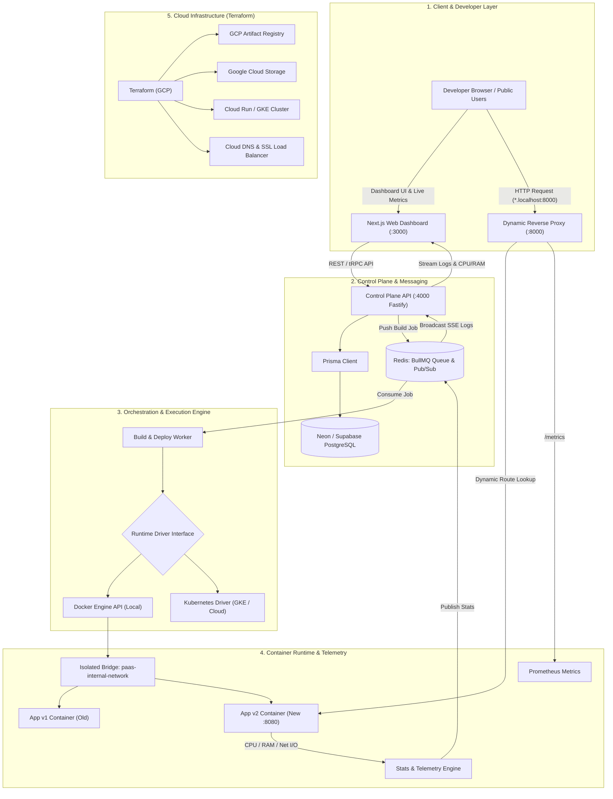
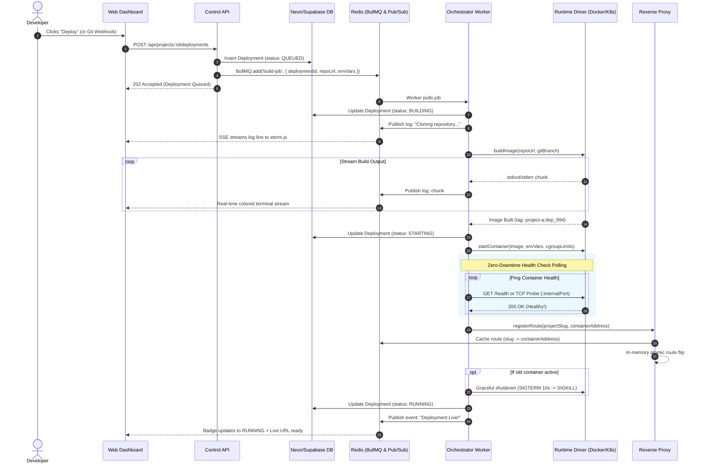
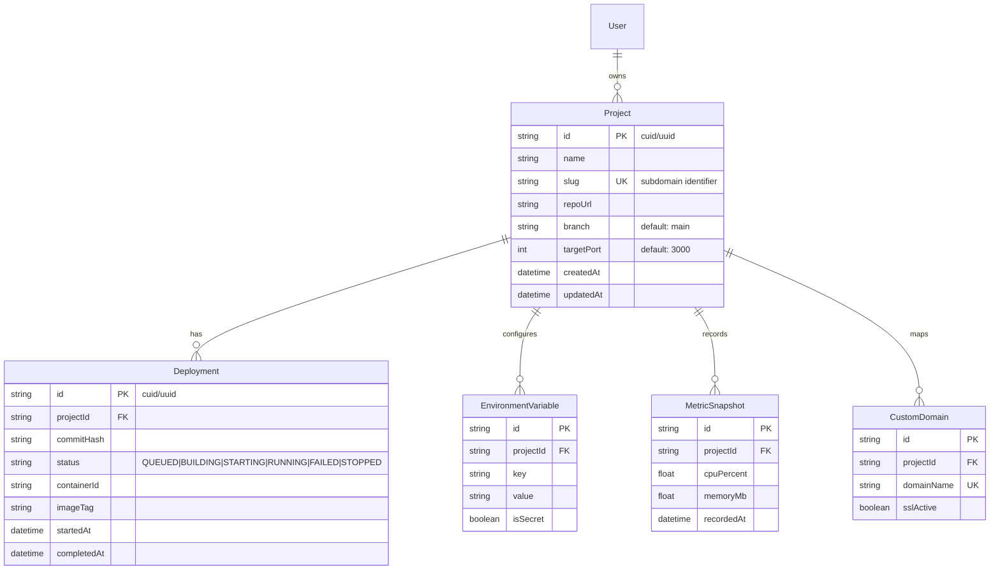

# Mini-Render / Railway: Backend Application Deployment Platform
## Comprehensive Architectural Specification (v2.0 - Cloud Native & Enterprise Grade)

---

### 1. Executive Summary

The platform is an enterprise-grade, cloud-ready **Platform as a Service (PaaS)** for deploying containerized backend applications (Node.js, Python, Go, Rust, Ruby, Dockerfiles). 

A developer connects any Git repository and specifies environment variables. The platform automatically:
1. **Queues & Orchestrates via Redis:** Jobs are queued via BullMQ to decouple HTTP API requests from resource-heavy builds.
2. **Builds with Multi-Runtime Drivers:** Compiles code into an OCI container image using either the **Docker Engine API** (local development) or a **Kubernetes Pod Driver** (production GKE/Cloud Run).
3. **Deploys with Zero Downtime:** Spins up the container on an isolated internal network (`paas-internal-network`), enforces cgroup limits (CPU/RAM/PIDs), verifies health checks (`GET /health`), dynamically switches the reverse proxy routing table, and gracefully terminates old containers.
4. **Routes Traffic:** Intercepts wildcard hostnames (`http://<project-slug>.localhost:8000` or custom domains) with Prometheus latency/throughput telemetry.
5. **Real-time Observability & Telemetry:** Streams build and container logs via **Redis Pub/Sub** to the browser (`xterm.js`), while streaming real-time CPU & RAM usage graphs.
6. **Infrastructure as Code (IaC):** Codifies all cloud infrastructure using **Terraform** for Google Cloud Platform (GCP).

---

### 2. High-Level System Architecture



---

### 3. Asynchronous Deployment Lifecycle (Sequence Diagram)



---

### 4. Core System Subsystems & Interfaces

#### A. Asynchronous Queue & Messaging (Redis & BullMQ)
* **Job Queue:** Isolates heavy compiler/Docker commands from the HTTP API.
* **Concurrency Limiting:** Enforces maximum parallel builds (e.g. 2 simultaneous builds on dev machine, scalable horizontally in cloud).
* **Pub/Sub Channels:**
  * `deployments:<id>:logs` → Streamed to SSE clients.
  * `deployments:<id>:status` → Real-time status badge transitions.
  * `projects:<id>:metrics` → Streamed CPU/RAM usage.

#### B. Pluggable Runtime Driver Interface
The orchestrator is decoupled from the specific container daemon:
```typescript
export interface ContainerRuntimeDriver {
  buildImage(options: BuildOptions): Promise<BuildResult>;
  startContainer(config: ContainerConfig): Promise<RunningContainer>;
  pollHealth(containerId: string, timeoutMs: number): Promise<boolean>;
  getStats(containerId: string): Promise<ContainerStats>; // CPU %, Memory MB
  stopContainer(containerId: string, gracePeriodMs: number): Promise<void>;
  getLogsStream(containerId: string): NodeJS.ReadableStream;
}
```
* **`DockerDriver`:** Uses `dockerode` over local `/var/run/docker.sock`.
* **`KubernetesDriver`:** Uses `@kubernetes/client-node` to orchestrate K8s Pods, ReplicaSets, and ClusterIP Services on GKE.

#### C. Observability & Telemetry Architecture
* **Prometheus Metrics:** The Reverse Proxy exports:
  * `http_requests_total{slug, status_code}`
  * `http_request_duration_seconds{slug, quantile}`
  * `active_deployments_total`
* **Resource Monitoring:** Orchestrator queries cgroups memory/CPU stats every 3 seconds:
  ```typescript
  interface ContainerStats {
    cpuPercentage: number;
    memoryUsageBytes: number;
    memoryLimitBytes: number;
    networkRxBytes: number;
    networkTxBytes: number;
  }
  ```
* **Dashboard Telemetry:** Next.js UI charts live CPU/RAM utilization curves for each running project.

#### D. Dynamic Reverse Proxy & Edge Routing
* Subdomain extraction: `http://<slug>.localhost:8000` → `slug`.
* Fast route lookup: In-memory `Map<string, RouteTarget>` backed by Redis invalidation.
* Transparent WebSocket and HTTP proxying using `http-proxy`.
* Custom error boundary:
  * 503 Bad Gateway with human-readable "Container Starting..." auto-refreshing landing page.

#### E. Infrastructure as Code (Terraform for GCP)
Directory: `infra/terraform/gcp/`
* `main.tf`, `variables.tf`, `outputs.tf`
* Provisions:
  1. **Google Artifact Registry:** Stores custom base images and built user containers.
  2. **Google Cloud Run / GKE:** Serverless container cluster.
  3. **Cloud Memorystore for Redis:** Managed high-throughput Redis instance.
  4. **Google Cloud Storage (GCS):** Stores build logs and build cache bundles.
  5. **Cloud Load Balancing & Cloud Armor:** Wildcard HTTPS termination and DDoS protection.

---

### 5. Database Schema (Neon / Supabase PostgreSQL)



---

### 6. Container Security & Sandboxing (cgroups)

To protect host hardware from runaway processes and malicious code:
* **Memory Limits:** `Memory: 536870912` (512 MB hard cap).
* **Swap Memory:** `MemorySwap: 536870912` (Swap disabled to prevent disk thrashing).
* **CPU Quota:** `NanoCPUs: 1000000000` (Max 1.0 vCPU core).
* **Process Limit:** `PidsLimit: 100` (Mitigates fork bombs).
* **Non-Root Execution:** App runs under unprivileged container user (`USER node` / `USER appuser`).
* **Isolated Network:** Attached strictly to `paas-internal-network` (containers cannot reach host ports).
